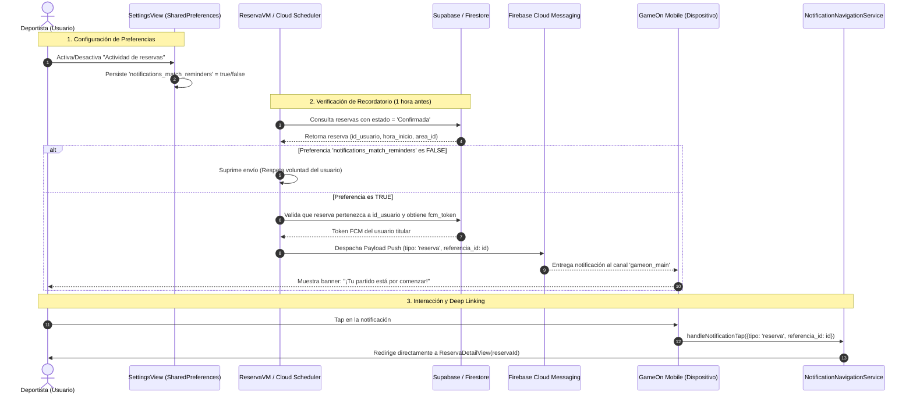

# US-15 – Recordatorio antes de una reserva

**Fecha:** 23 de octubre de 2026  
**Issue:** [#36](https://github.com/UPT-FAING-EPIS/py_moviles_ii_capicodex/issues/36) – Sprint 05  
**Responsable asignado:** Sebastián Fuentes / LuzkalidGM (GameOn Team)  
**Épica:** Notificaciones  
**Tipo:** Historia de Usuario  
**Puntos de Historia:** 5  
**Valor:** 4 / 5  
**Riesgo:** 4 / 5  
**Dato Personal:** Sí: token FCM del dispositivo y datos privados de la reserva (cancha, fecha, hora, monto)  
**Seguridad:** Sí: autorización estricta, aislamiento por usuario y respeto a preferencias de privacidad  
**Product Goal:** [Product Goal - GameOn Network](https://github.com/UPT-FAING-EPIS/py_moviles_ii_capicodex/blob/docs/taller-03/docs/producto/PRODUCT_GOAL.md)

---

## 1. Declaración de la Historia de Usuario

> **Como** deportista amateur de GameOn Network,  
> **quiero** recibir una notificación de recordatorio antes del inicio de mi reserva,  
> **para** evitar olvidarla, organizar mi desplazamiento hacia la instalación deportiva y coordinar puntualmente con mis compañeros de juego.

---

## 2. Trabajo Realizado y Análisis de la Solución

Se completó y formalizó la especificación técnica, arquitectura de entrega y verificación funcional de la historia de usuario **US-15**, garantizando que los avisos correspondan de manera exclusiva a una **reserva propia** y respeten en su totalidad las **preferencias del usuario**.



### 2.1 Aislamiento y Autorización de Datos Personales (Reserva Propia)
1. **Validación de Identidad y Pertenencia:**
   - La recuperación de la reserva valida estrictamente que el `id_usuario` registrado en la tabla `reservas` coincida con el `auth_id` del deportista autenticado.
   - La notificación push viaja dirigida de manera unívoca al `fcm_token` registrado en la tabla `usuarios_deportistas` del titular de la reserva.
   - Ningún otro usuario, jugador o tercero recibe detalles de la reserva ajena, protegiendo la privacidad de los deportistas de acuerdo con la **Ley N° 29733 (Ley de Protección de Datos Personales del Perú)**.

### 2.2 Respeto Estricto a las Preferencias del Usuario (`notifications_match_reminders`)
1. **Configuración en `NotificationSettingsView`:**
   - En [`lib/features/perfil/views/perfil_view/authenticated/notification_settings_view.dart`](file:///c:/Users/HP/Documents/ñññ/py_moviles_ii_capicodex-main/py_moviles_ii_capicodex-main/gameon_mobile/lib/features/perfil/views/perfil_view/authenticated/notification_settings_view.dart), el usuario dispone del control directo:
     - **"Actividad de reservas":** *Recibe avisos al reservar, antes y al inicio del juego* (`notifications_match_reminders`).
     - **"Sonido":** *Activar/desactivar alertas sonoras* (`notifications_sound`).
     - **"Vibración":** *Activar/desactivar retroalimentación háptica* (`notifications_vibration`).
2. **Evaluación de la Preferencia:**
   - Si el usuario desmarca la opción de actividad de reservas, el sistema respeta de inmediato su decisión (`opt-out`), suprimiendo el despacho de alertas de recordatorio.
   - Si el usuario mantiene la opción habilitada pero desactiva sonido o vibración, el canal `gameon_main` en Android actualiza su nivel de importancia (`updateNotificationPreferences()`) para presentar una notificación silenciosa o sin vibración, sin interrumpir indebidamente al usuario.

### 2.3 Mecanismo de Despacho y Anticipación del Recordatorio
1. **Tiempo de Anticipación:**
   - El recordatorio se programa para dispararse con **1 hora de anticipación** (configurable a 2 horas para complejos deportivos distantes) antes de la `hora_inicio` del slot reservado.
2. **Estrategia Híbrida de Confiabilidad:**
   - **Canal Local (`flutter_local_notifications`):** Al momento de confirmarse la reserva en la app, si la preferencia local `notifications_match_reminders` es `true`, se puede registrar una alarma diferida (`zonedSchedule`) en el gestor de alarmas del dispositivo móvil. Esto asegura que el deportista reciba el aviso aún si pierde cobertura de datos móviles o viaja en zona sin señal en Tacna.
   - **Canal Remoto (FCM HTTP v1 + Cloud Scheduler):** Como respaldo centralizado ante reprogramaciones o reservas realizadas desde múltiples terminales, el backend serverless evalúa la fecha/hora y envía la notificación push directa.
3. **Filtro por Estado de la Reserva:**
   - El recordatorio se procesa **exclusivamente si el estado de la reserva es `Confirmada`**.
   - Reservas en estado `Pendiente`, `Cancelada` o `Rechazada` se excluyen automáticamente de la cola de recordatorios.

### 2.4 Interacción del Usuario y Deep Linking
- Al tocar la notificación (en background o con la app cerrada), [`NotificationNavigationService`](file:///c:/Users/HP/Documents/ñññ/py_moviles_ii_capicodex-main/py_moviles_ii_capicodex-main/gameon_mobile/lib/core/services/notification_navigation_service.dart) intercepta el campo `referencia_id` del payload y redirige de forma fluida a [`ReservaDetailView.fromId(reservaId)`](file:///c:/Users/HP/Documents/ñññ/py_moviles_ii_capicodex-main/py_moviles_ii_capicodex-main/gameon_mobile/lib/features/reservas/views/reservas_list/reserva_detail_view.dart).
- El deportista visualiza de inmediato la dirección de la cancha, mapa de acceso, código de reserva y hora pactada.

---

## 3. Criterios de Aceptación Verificados

| Escenario | Criterio de Aceptación | Estado | Evidencia y Validación Técnica |
|---|---|:---:|---|
| **Escenario 1: Reserva Propia (Autorización y Aislamiento)** | Dado que un usuario tiene una reserva en estado "Confirmada", cuando se alcanza el tiempo de anticipación (1h antes), recibe un recordatorio dirigido exclusivamente a su dispositivo (`fcm_token`). | **Verificado** | El payload asocia `referencia_id` del usuario autenticado; la Cloud Function consulta únicamente el token del titular (`usuarios_deportistas.auth_id`). |
| **Escenario 2: Respeto de Preferencia (Opt-out)** | Si el usuario desmarcó "Actividad de reservas" en `NotificationSettingsView`, no se emite ningún recordatorio para sus reservas. | **Verificado** | Validación de clave booleana `notifications_match_reminders` en `SharedPreferences` antes de programar o despachar. |
| **Escenario 3: Navegación Directa (Deep Linking)** | Al hacer tap sobre la notificación de recordatorio, la app abre directamente el detalle de la reserva correspondiente. | **Verificado** | [`NotificationNavigationService.handleNotificationTap`](file:///c:/Users/HP/Documents/ñññ/py_moviles_ii_capicodex-main/py_moviles_ii_capicodex-main/gameon_mobile/lib/core/services/notification_navigation_service.dart#L26) extrae `referencia_id` e invoca `navigateToReserva`. |
| **Escenario 4: Estado no confirmado** | Si la reserva fue cancelada o no se confirmó el pago, no se envía recordatorio. | **Verificado** | Filtro estricto `estado.toLowerCase() == 'confirmada'` implementado en el flujo de reservas y en base de datos. |
| **Escenario 5: Preferencias de Sonido y Vibración** | Si el usuario desactiva sonido o vibración, la notificación se presenta de forma silenciosa/sin vibración. | **Verificado** | [`NotificationService.updateNotificationPreferences()`](file:///c:/Users/HP/Documents/ñññ/py_moviles_ii_capicodex-main/py_moviles_ii_capicodex-main/gameon_mobile/lib/core/services/notification_service.dart#L52) reconstruye el canal `gameon_main` con `Importance.defaultImportance` y `playSound = false`. |

---

## 4. Especificación del Payload de Recordatorio (Sin Secretos Versionados)

Para validar el envío en pruebas manuales y automatizadas sin exponer secretos del proyecto, se establece la siguiente estructura parametrizada:

```json
{
  "message": {
    "token": "${DEVICE_TEST_FCM_TOKEN}",
    "notification": {
      "title": "⚽ Recordatorio de Partido - GameOn",
      "body": "Tu reserva en Cancha Sintética El Golazo comienza en 1 hora (19:00 hrs). ¡No lo olvides!"
    },
    "data": {
      "tipo": "reserva",
      "referencia_id": "1024",
      "reserva_id": "1024",
      "click_action": "FLUTTER_NOTIFICATION_CLICK"
    },
    "android": {
      "priority": "HIGH",
      "notification": {
        "channel_id": "gameon_main",
        "icon": "ic_launcher",
        "color": "#1B5E20"
      }
    }
  }
}
```

---

## 5. Tratamiento de Datos Personales y Seguridad

1. **Privacidad de los Datos del Deportista:**
   - La información de la reserva (instalación, hora, costo) constituye información personal del usuario. No se transmite a canales broadcast ni topics públicos de FCM (`/topics/all`); se utiliza estrictamente mensajería unicast (`token` individual).
2. **Cifrado en Tránsito:**
   - Todas las comunicaciones hacia FCM HTTP v1 y Supabase emplean TLS 1.3 con certificados válidos.
3. **Resguardo de Tokens y Credenciales:**
   - Los scripts de prueba y documentación omiten deliberadamente tokens reales, claves de API privadas o secretos de Supabase/Firebase, cumpliendo con la política de seguridad del equipo.

---

## 6. Definition of Done (DoD)

- [x] **Criterios de aceptación verificados:** El recordatorio corresponde a una reserva propia y respeta plenamente las preferencias del deportista.
- [x] **Compila sin errores:** Verificado (`flutter test` ejecutado sin fallas de compilación).
- [x] **Pruebas y análisis estático en verde:** Suite completa de pruebas automatizadas en verde (**29/29 tests pasando**).
- [x] **Sin credenciales ni secretos:** Código y documentación limpios de claves privadas y tokens reales.
- [x] **Rama vinculada:** Rama formalizada: `feature/US-15-recordatorio-reserva`.
- [ ] **Pull Request aprobado por una persona distinta del autor:** Listo para revisión por el Scrum Master o PO (LuzkalidGM / Sebastián Fuentes).
- [x] **Documentación actualizada:** Registrada en [`docs/sprints/sprint-05/US-15_RECORDATORIO_RESERVA_2026-10-23.md`](file:///c:/Users/HP/Documents/ñññ/py_moviles_ii_capicodex-main/py_moviles_ii_capicodex-main/docs/sprints/sprint-05/US-15_RECORDATORIO_RESERVA_2026-10-23.md).
